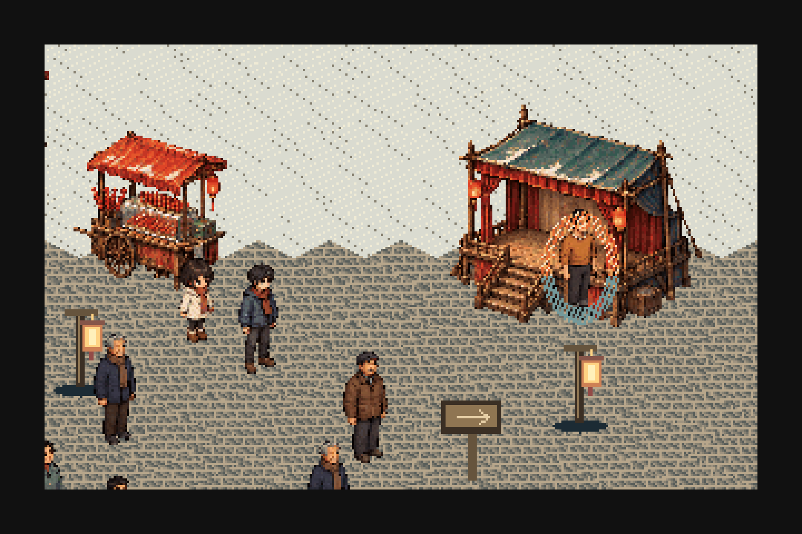
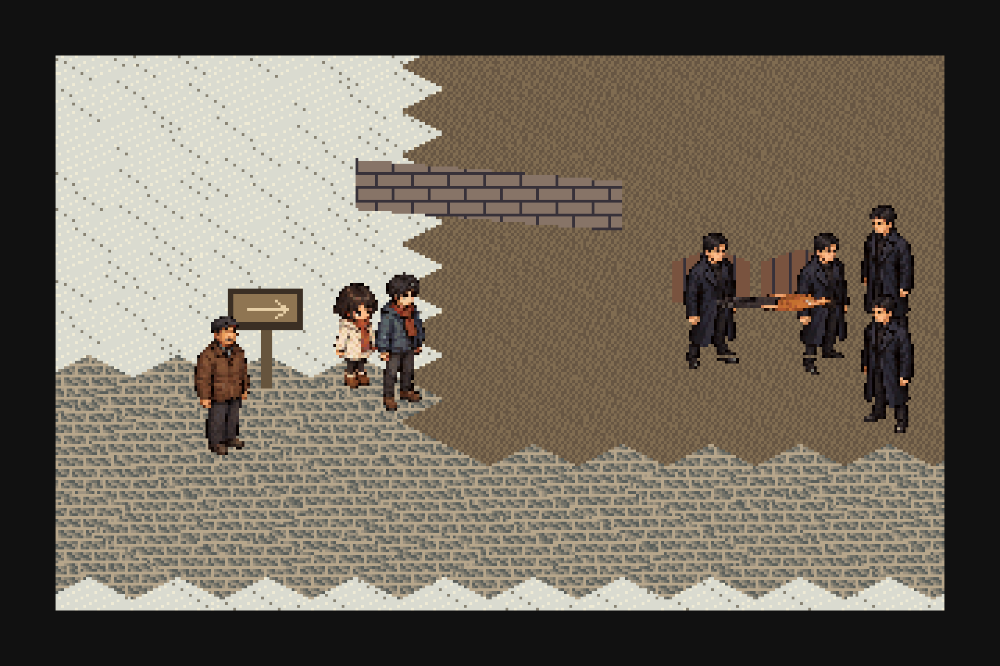
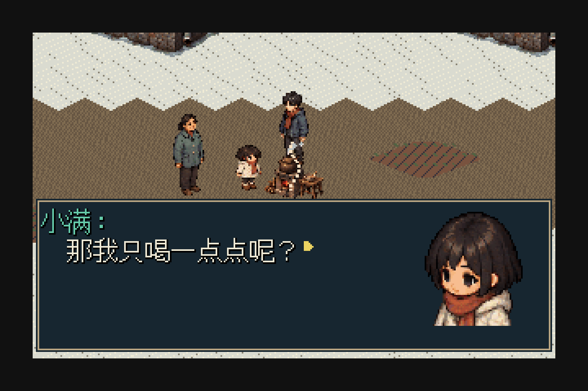
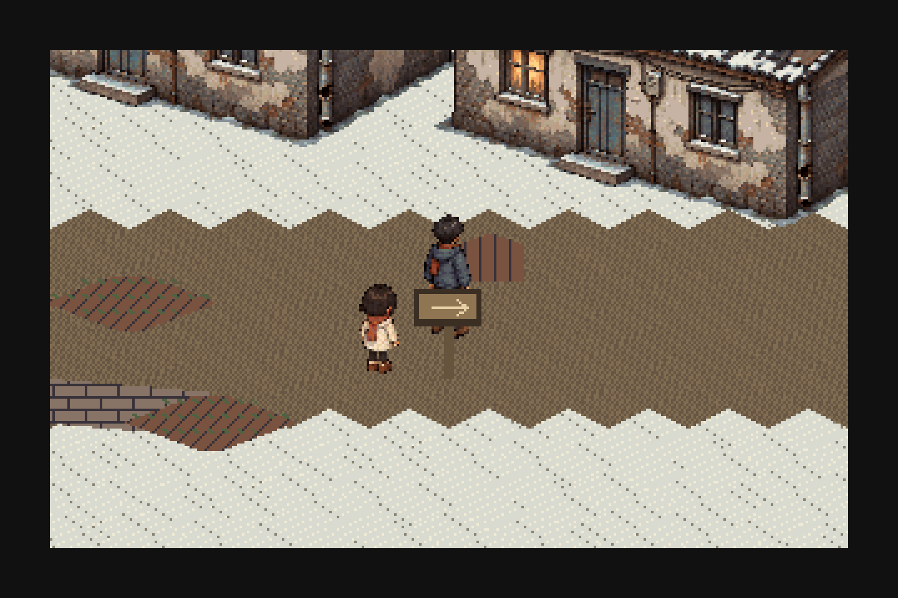

# T1.5 开篇精修：场景、原生演出与交付证据

[当前试玩 /chapter/](https://lantern-inn-typepal-t1.ardentfern6.chatgpt.site/chapter/) · [上一版 /pilot/](https://lantern-inn-typepal-t1.ardentfern6.chatgpt.site/pilot/)

## 验证范围

| 证据 | 范围与结果 |
|---|---|
| Run38939704086 | 首轮市场/购买通过，舞台选点误选摊主，真实FAIL保留 |
| Run38940074923 | 新章九项流程/原生帧与位置/存档分域检查PASS；1113采样中火焰6帧、飞火14个位置、搬运18个位置 |
| Run38940771024 | 从前次真实原生检查点续测倒地保持、身体遮挡、药锅镜头与家门边缘，3项PASS；3个观测画面黑区均0 |
| Run38941303641 | 锅旁站位断言FAIL；实际同伴轨迹与此前猜测不同，未放行 |
| Run38941699334 | 锅旁距离与新构建隔离PASS，画面复核仍发现邻居遮住孩子 |
| Run38942172446 | 最后锅旁站位/轮廓PASS，孩子与邻居投影水平分离36px；只续测该范围 |
| 作者工程 | 4地图/4场景/43资源/65文件；官方检查通过；63条私有cue确实进入native场景 |
| 路线 | 90个交互侧入口、280段逐轴approach，避开可碰撞人物足点 |
| 交付一致性 | 433个完整运行路径；与最后CI相比381文件逐字节相同，52文件仅私有内容文字呈现差异；新native机制/资产65文件一致 |

GitHub Actions证据可从对应run的`type-pal-t15-evidence`下载，包含实际Chromium截图、录像、只读native trace、公共工程和运行清单。飞火录像约15.3秒处可看到空中的独立投射物；它不是只用屏幕摇动来代表施法。首次/完整流程及修正结果JSON均在本目录，精确测试头SHA和部署信息见RELEASE.json。

## 实际画面（公开原创替代文本）

[设计与仙剑内容对照](../../docs/T15_SCENERY_AND_CINEMATICS.md) · [失败经验与保留边界](FAILURES_AND_LIMITS.md)
